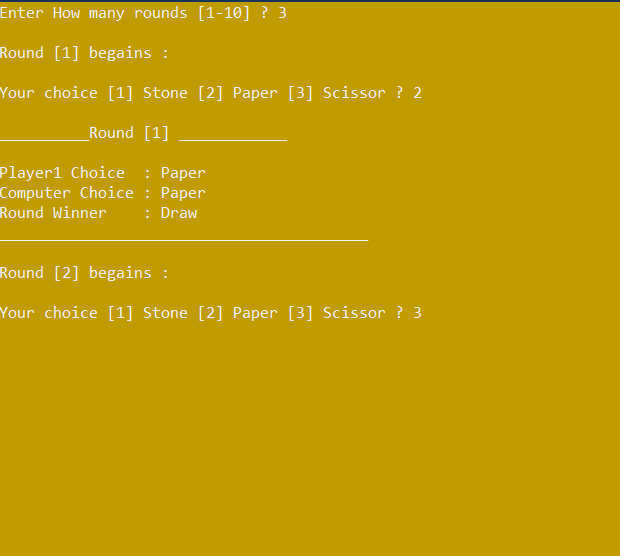
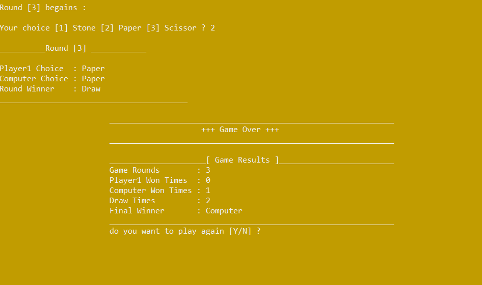

# 🪨 Stone Paper Scissors Game

A simple console-based Stone, Paper, Scissors game where the player competes against the computer. Each round results in a win, a loss, or a draw based on the player's choice and the computer's randomly generated move.

## 📌 Overview

This project was developed to practice fundamental C++ programming concepts, including enumerations ("enum"), loops, functions and procedures, variables, and input/output streams.

It also focuses on procedural programming and applying the Divide and Conquer strategy by breaking the program into smaller, independent tasks, making the code more organized, readable, and maintainable.

## ✨ Features

- Customizable Rounds: The player chooses the number of rounds before the game begins.
- Game Summary: Displays the number of won, lost, and drawn rounds, along with the final game winner.
- Play Again: Allows the player to restart the game without relaunching the application.
- Input Validation: Handles invalid user input to ensure a smoother gameplay experience.
- Modular Design: Each task is implemented in a separate function to improve code organization and maintainability.
- Random Computer Moves: Uses C++'s "rand()" function to generate a random number representing the computer's move.

## 🛠️ Technologies Used

- Language: C++
- IDE: Microsoft Visual Studio

## 📸 Screenshots

### Main Game Screen

### Game Results

🚀 Getting Started

## Prerequisites

- Microsoft Visual Studio with C++ development tools installed.
- Git (optional, for cloning the repository).

## Installation

1. Clone the repository:
   
   git clone YOUR_REPOSITORY_URL
   
   Alternatively, download the project files directly from GitHub.

2. Open the solution file (".sln") in Visual Studio.

3. Build the solution.

4. Run the application and enjoy the game!

## 🧠 Concepts Practiced

- Fundamental C++ programming concepts.
- Enumerations ("enum").
- Loops, functions, and procedures.
- Input and output streams.
- Input validation and error handling.
- Procedural programming.
- Divide and Conquer problem-solving strategy.
- Random number generation using "rand()".

## 📂 Project Structure

StonePaperScissors/
├── Images/
│   ├── p1.png
│   └── p1part2.png
├── .gitattributes
├── .gitignore
├── ConsoleApplicationForGitHub.sln
├── ConsoleApplicationForGitHub.vcxproj
├── LICENSE.txt
└── README.md

## 👨‍💻 Author

Osama Arafat

- GitHub: "@ososdays" (https://github.com/ososdays)

## 📄 License

This project is licensed under the MIT License. See the "LICENSE.txt" file for details.
